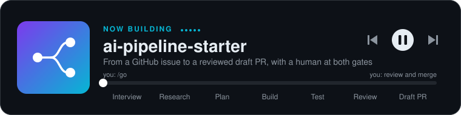

# Hi, I'm Gil 👋

Forward-deployed engineer building AI tools for large, regulated organizations. I focus on the hard part: getting them approved, trusted, and adopted.

## Focus

- **AI-assisted software engineering**, with humans in the loop
- **Enterprise adoption of AI tools** in regulated industries
- **Measuring** whether a tool actually helps

## Featured

A kit that turns a GitHub issue into a reviewed draft pull request using AI agents (interviewer, researcher, planner, developer, tester, reviewer). Humans approve at the start and at the merge, retries are bounded, and every feature is labeled as verified live, tested locally, or written but not yet run.

`Python` · `GitHub Actions` · `Claude` · `Devin`

## Stack

## Activity

## Now

Part-time M.S. in Computer Science & AI at Boston University. Interested in early-stage companies bringing AI into large institutions.

Views and projects here are my own.
